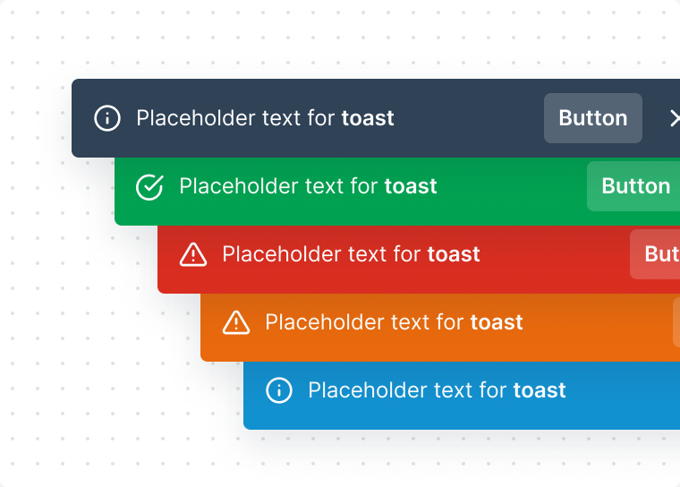
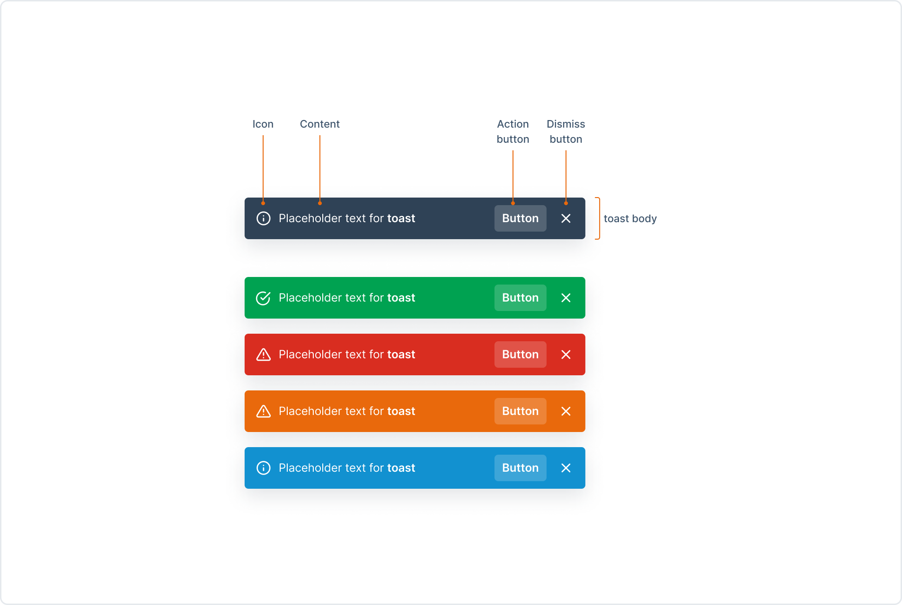
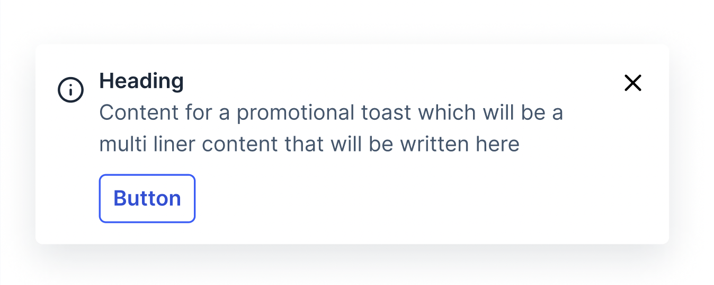

# Toast 🏷️

Toasts are used to provide feedback to the user after an important action has been performed. 
Toasts can also be used to provide feedback to the user when a system event occurs, such as when a file is saved.



## Design

- [Toast - Figma Design](https://www.figma.com/file/jubmQL9Z8V7881ayUD95ps/Blade-DSL?type=design&node-id=7665-27414&mode=design&t=UNInCMmP1iFCu9je-0)

## Features

- Stackable
- Auto dismissable / manual dismissable
- `informational` or `promotional` types

## Anatomy

### Informational Toast



### Promotional Toast



## Simple Usage

The blade toasts will use [react-hot-toast](https://react-hot-toast.com/) under the hood with a similar imperative API to show, dismiss and create new toasts without needing for consumer to handle positional or stacking logic. 

```jsx
import { BladeProvider, ToastContainer, useToast } from "@razorpay/blade/components"

const HomePage = () => {
  const toast = useToast();

  return (
    <Button
      onClick={() => {
        toast.show({
          type: 'informational',
          color: 'success',
          content: 'Payment Successful',
          leading: <DollarIcon />,
          autoDismiss: true,
          onDismissButtonClick: () => {
            console.log('Toast dismissed');
          },
          action: {
            text: 'View',
            onClick: () => {
              console.log('Toast action clicked');
            }
          }
        });
      }}
    >
      Show Toast
    </Button>
  );
};

const App = () => {
  return (
    <BladeProvider>
      <ToastContainer position="bottom-left" />
      <HomePage />
    </BladeProvider>
  )
}
```

## Props

```ts
type ToastProps = {
  /**
   * @default `informational`
   */
  type?: 'informational' | 'promotional';

  /**
   * @default `neutral`
   */
  color?: 'neutral' | 'positive' | 'negative' | 'notice' | 'information'

  /**
   * Content of the toast
   */
  content: React.ReactNode;

  /**
   * Can be used to render an icon or asset
   */
  leading?: React.ReactElement;

  /**
   * If true, the toast will be dismissed after few seconds
   * 
   * @default true - for informational toast
   * @default false - for promotional toast
   */
  autoDismiss?: boolean;

  /**
   * Duration after which the toast will be dismissed (in ms)
   * 
   * Duration for promotional toast is 8s
   * Duration for informational toast is 4s
   */
  duration?: 8000 | 4000;

  /**
   * Called when the toast is dismissed or duration runs out
   */
  onDismissButtonClick?: () => void;

  /**
   * Primary action of toast
   */
  action?: {
    text: string;
    onClick?: (e: Event) => void;
    isLoading? boolean;
  }

  /**
   * Forwarded to react-hot-toast
   * 
   * This can be used to programatically update toasts by providing an id
   */
  toastId?: string; 
}
```

### useToast

The useToast hook will return few modified methods from [react-hot-toast](https://react-hot-toast.com/docs/toast): 

```ts
type useToastReturnType = {
  /**
   * @returns id of the toast
   */
  show: (toast: Toast) => string;

  /**
   * id of the toast to be dismissed
   * 
   * if id is not provided, all the toasts will be dismissed
   */
  dismiss: (toastId?: string) => void;
}
```

## Examples

#### Removing a toast

react-hot-toast provides this functionality, for more info see [react-hot-toast docs](https://react-hot-toast.com/docs/toast#dismiss-toast-programmatically)

```jsx
import { BladeProvider, ToastContainer, useToast } from "@razorpay/blade/components"

const Example = () => {
  const toastId = React.useRef(null);
  const toast = useToast();

  return (
    <Box>
      <Button
        onClick={() => {
          toastId.current = toast.show({
            color: 'success',
            content: 'Payment Successful',
          });
        }}
      >
        Show Toast
      </Button>
      <Button onClick={() => toast.dismiss(toastId.current)}>Dismiss Toast</Button>
    </Box>
  );
};
```

### Promotional Toast

```jsx
import { BladeProvider, ToastContainer, useToast } from "@razorpay/blade/components"

const Example = () => {
  const toast = useToast();

  return (
    <Button
      onClick={() => {
        toast.show({
          type: 'promotional',
          content: (
            <Box>
              <Heading>Payment Successful</Heading>
              <Text>Amount: ₹100</Text>
            </Box>
          ),
          leading: <DollarIcon />,
          action: {
            text: 'Okay'
          }
        });
      }}
    >
      Do payment
    </Button>
  );
};
```


## Motion

You can checkout the toast motion [here](https://www.figma.com/proto/jubmQL9Z8V7881ayUD95ps/Blade-DSL?type=design&node-id=75848-1063056&t=QZkki0ZrlcG4sKzw-0&scaling=min-zoom&page-id=7665%3A27414).

## Accessibility

- Toast components will follow the WAI-ARIA guidelines for [alert](https://www.w3.org/WAI/ARIA/apg/patterns/alert/examples/alert/). For error toast we will use the `alert` role and for informational toast we will use the `status` role.


## References

- https://react-hot-toast.com/docs
- https://chakra-ui.com/docs/components/toast/usage

## Open Questions

- Q. What should be the default duration for auto dismissable toasts?
  - A. 4s for informational toasts and 8s for promotional toasts

- Q. Should we call it `onDismissButtonClick` or `onDismiss`? 
  
- Q. Should the dismiss handler be called even when the toast is auto dismissed? Or should we have different handlers for auto dismiss and manual dismiss? (eg: `onAutoDismiss` `onDismissButtonClick`)
  - A. We will call it `onDismissButtonClick` and it will only be called when the user clicks on the dismiss button.

- Q. In the `useToast` hook should we call the returned functions `showToast`/`dismissToast` or `show`/`dismiss`?

  If we call them `show` & `dismiss` consumer can do this and might look more cleaner:

  ```jsx
  const App = () => {
    const toast = useToast();

    toast.show(); // <-- they will also get auto complete when writing `toast.`
    toast.dismiss();
  }
  ```
  - A. We will call them `show` & `dismiss`

- Q. In design we are restricting the Toast position to be bottom-left. In that case should we also do the same or should we allow all the positions & set the default to bottom-left? (If we allow all the positions, we will have to add some additional logic to handle stacking/animation of toasts coming from top instead of bottom)
  - A. We will only allow bottom-left position for now.

- Q. Should we keep the ToastContainer inside BladeProvider? 

  The problem is if we keep it inside BladeProvider, given our new light/dark mode setup where consumers will need to nest BladeProviders it would cause ToastContainer to render [multiple times](https://github.com/razorpay/blade/pull/1990#discussion_r1470796627).
  - A. We will expose ToastContainer, so that users can render it at the root level of their app regardless of where BladeProvider is.

---

## Promotional Toast: Timer, Progress Bar and Link Action

Promotional toasts get these additions on web. A promotional toast can play its own intro motion before its timer starts. It can show a thin progress bar for the time left. Its action can render as a `Button` or a `Link`. A promotional toast that auto dismisses pauses while the pointer is over it or focus is inside it.

### API

```jsx
import { ArrowRightIcon, Box, Heading, Text, useToast } from '@razorpay/blade/components';

const toast = useToast();

toast.show({
  type: 'promotional',
  content: (
    <Box display="flex" gap="spacing.2" flexDirection="column">
      <Heading size="small">Reports are now faster</Heading>
      <Text size="small">Download any report in a few seconds.</Text>
    </Box>
  ),
  autoDismiss: true,
  duration: 8000,
  introDuration: 2000,
  showProgressBar: true,
  action: {
    text: 'See what is new',
    variant: 'link',
    href: 'https://example.com/whats-new',
    target: '_blank',
    icon: ArrowRightIcon,
    iconPosition: 'right',
  },
});
```

- `introDuration` delays the auto dismiss timer and the progress bar. The consumer plays the intro motion inside `content`. Blade does not animate the content.
- With `introDuration`, Blade holds the action and the progress bar until the intro ends, then fades them in. The bar starts to shrink at the same time. Both keep their space during the intro, so nothing moves. The dismiss button shows from the start.
- `showProgressBar` shows a 2px bar on the bottom edge of the toast. The bar shrinks from full width to zero over `duration` with linear easing.
- The timer and the bar pause when a mouse pointer is over the toast or keyboard focus is inside it. They resume from where they stopped. A touch tap and focus from a mouse click do not pause. A remount of `ToastContainer` keeps the time left.
- `action.variant: 'link'` renders a `Link`. It renders an anchor when `href` is given, else a button element.

<details>
  <summary>Alternate APIs</summary>

#### Alternate API 1: `actions` with `primary` and `secondary`, like Alert

```jsx
toast.show({
  type: 'promotional',
  content: <Text>Reports are now faster</Text>,
  actions: {
    primary: { text: 'Try now', onClick: () => {} },
    secondary: { text: 'Learn more', href: 'https://example.com' },
  },
});
```

- Pros
  - Same shape as `Alert` and `Card` footer actions.
  - Allows a button and a link at the same time.
- Cons
  - Breaking change. `action` exists today and consumers use it.
  - The toast design has one call to action. Two actions add a layout that the design does not have.

#### Alternate API 2: `delay` as a motion token instead of `introDuration`

```jsx
toast.show({
  type: 'promotional',
  content: <IntroContent />,
  autoDismiss: true,
  delay: 'long',
});
```

- Pros
  - Uses the `motion.delay` token scale.
- Cons
  - The intro length belongs to the consumer's own motion. It is rarely a token value.
  - `delay` reads as a delay before the toast shows, not before the timer starts.
  - `duration` is a number in ms today. `introDuration` keeps the same unit and the same naming pattern. Consumers can still pass a token value, for example `theme.motion.delay.long`.

#### Alternate API 3: render the `ProgressBar` component instead of an internal bar

```jsx
<ProgressBar value={timeLeftPercent} size="small" showPercentage={false} />
```

- Pros
  - Reuses an existing component.
- Cons
  - `ProgressBar` takes a value from JS. A countdown needs a state update on every frame.
  - `ProgressBar` animates value changes with stepped easing, not linear.
  - `ProgressBar` has `role="progressbar"`. A screen reader then reads a countdown that has no meaning for the user.
  - A CSS keyframe with `animation-play-state` pauses and resumes the bar with no extra state.

</details>

### Props

#### ToastProps (additions)

```typescript
type ToastProps = {
  // ...existing props

  /**
   * Time in ms of the intro motion that `content` plays.
   * Blade holds the action and the progress bar until the intro ends, then fades them in.
   * With `autoDismiss`, the timer and the progress bar also start after the intro.
   *
   * Works only on promotional toasts.
   *
   * @platform web
   * @default 0
   */
  introDuration?: number;

  /**
   * Shows a progress bar for the time left before the toast dismisses.
   *
   * Works only on promotional toasts with `autoDismiss`.
   *
   * @platform web
   * @default false
   */
  showProgressBar?: boolean;

  /**
   * Primary action of toast
   */
  action?: ToastButtonAction | ToastLinkAction;
};
```

#### ToastAction

```typescript
type ToastActionCommon = {
  text: string;
  /**
   * @platform web
   */
  icon?: IconComponent;
  /**
   * @platform web
   * @default 'left'
   */
  iconPosition?: 'left' | 'right';
};

type ToastButtonAction = ToastActionCommon & {
  /**
   * Renders the action as a `Button` or a `Link`
   *
   * @platform web
   * @default 'button'
   */
  variant?: 'button';
  onClick?: (args: { event: React.MouseEvent<HTMLButtonElement>; toastId: string }) => void;
  isLoading?: boolean;
};

type ToastLinkAction = ToastActionCommon & {
  variant: 'link';
  /**
   * With `href`, the event comes from an anchor element
   */
  onClick?: (args: {
    event: React.MouseEvent<HTMLButtonElement | HTMLAnchorElement>;
    toastId: string;
  }) => void;
  /**
   * Renders an anchor when given, else a button element
   */
  href?: string;
  target?: string;
  /**
   * When `target` is `_blank`, `Link` sets this to `noreferrer noopener`
   */
  rel?: string;
};
```

### Examples

#### Promotional toast with a progress bar

The bar shows the time left. It pauses on hover and focus.

```jsx
toast.show({
  type: 'promotional',
  content: <Text size="small">Your settlement report is ready</Text>,
  autoDismiss: true,
  showProgressBar: true,
  action: { text: 'Download', onClick: ({ toastId }) => toast.dismiss(toastId) },
});
```

#### Promotional toast with a link action

The `Link` uses the `small` size. This matches the toast's `small` body text and the label size of the `xsmall` button.

```jsx
toast.show({
  type: 'promotional',
  content: <Text size="small">See the new reports page</Text>,
  action: {
    text: 'Learn more',
    variant: 'link',
    href: 'https://example.com',
    target: '_blank',
    icon: ArrowRightIcon,
    iconPosition: 'right',
  },
});
```

#### Promotional toast with an intro

The content shows an intro frame first, then the main frame. `introDuration` matches the intro, so the timer starts with the main frame. Both frames sit in one grid cell, so the toast height does not change.

```jsx
const IntroContent = ({ introDuration }) => {
  const [isIntroDone, setIsIntroDone] = React.useState(false);

  React.useEffect(() => {
    const timeout = setTimeout(() => setIsIntroDone(true), introDuration);
    return () => clearTimeout(timeout);
  }, [introDuration]);

  return (
    <Box display="grid">
      <Box gridArea="1 / 1" visibility={isIntroDone ? 'hidden' : 'visible'}>
        <IntroFrame />
      </Box>
      <Box gridArea="1 / 1" visibility={isIntroDone ? 'visible' : 'hidden'}>
        <MainFrame />
      </Box>
    </Box>
  );
};

toast.show({
  type: 'promotional',
  content: <IntroContent introDuration={2000} />,
  autoDismiss: true,
  introDuration: 2000,
  showProgressBar: true,
});
```

### Accessibility

- The progress bar has `aria-hidden`. It is decoration. The toast's `role="status"` stays the same.
- Keyboard focus (`:focus-visible`) inside the toast pauses the timer. A keyboard user can reach the action and the dismiss button before the toast dismisses.
- Pointer over the toast pauses the timer. The user gets more time to read the content.
- The link action renders `Link`. With `href` it is an anchor with link semantics. Without `href` it is a button element.
- `introDuration` adds no motion. The consumer owns the intro motion and its reduced motion behaviour.

### Open Questions

- Q. Which token fills the progress bar?
  - A. `interactive.background.neutral.default`. It is black in the light theme and white in the dark theme. `SliderInput` uses the same token for its filled track. Design to confirm.
- Q. Should the bar stop its animation when the user prefers reduced motion?
  - A. Open. The bar is a slow, linear change in width. The timer still runs. Design and accessibility to confirm.
- Q. Should React Native support these props?
  - A. Not now. The props are web only. Native ignores them.
- Q. Should informational toasts get the progress bar later?
  - A. Open. Informational toasts use react-hot-toast's timer. Their pause is global for the stack. A bar would need the Blade timer for informational toasts too.
- Q. Can multi-frame `content` change its height between frames?
  - A. Not now. `ToastContainer` measures the toast height once, at show. Keep every frame the same height, for example with one grid cell for all frames.

---

## Promotional Toast: Glass Variant

`variant: 'glass'` is an opt-in look for promotional toasts on web. The toast gets a lighter backdrop blur, a thinner border and a larger corner radius. It scales in and out from its centre instead of sliding. Toasts without `variant`, and all informational toasts, do not change.

### API

```jsx
import { ArrowRightIcon, Box, Heading, Text, useToast } from '@razorpay/blade/components';

const toast = useToast();

toast.show({
  type: 'promotional',
  variant: 'glass',
  content: (
    <Box display="flex" gap="spacing.2" flexDirection="column">
      <Heading size="small">Reports are now faster</Heading>
      <Text size="small">Download any report in a few seconds.</Text>
    </Box>
  ),
  autoDismiss: true,
  showProgressBar: true,
  action: {
    text: 'See what is new',
    variant: 'link',
    href: 'https://example.com/whats-new',
    target: '_blank',
    icon: ArrowRightIcon,
    iconPosition: 'right',
  },
});
```

- `variant` works only on promotional toasts. Informational toasts ignore it.
- The glass surface uses existing tokens only. Open Questions lists each mapping.
- Entry: scale 0.5 to 1, opacity 0 to 1, blur 0.5px to none. It uses `duration.moderate` and `easing.entrance`.
- Exit: scale 1 to 0.92, opacity 1 to 0. It uses `duration.quick` and `easing.exit`.
- The toast scales from its centre.
- `introDuration`, `showProgressBar`, the pause on hover and focus, and the link action work with both variants.

<details>
  <summary>Alternate APIs</summary>

#### Alternate API 1: `variant` plus `entryMotion`

```jsx
toast.show({
  type: 'promotional',
  variant: 'glass',
  entryMotion: 'scale',
  content: <Text size="small">Reports are now faster</Text>,
});
```

- Pros
  - The surface and the motion can change one at a time.
- Cons
  - Two props for one look. Consumers can make mixes that design did not draw, for example the default surface with the scale motion.
  - The glass look also changes the exit. `entryMotion` names the entry only, so the name does not match what it does.
  - Each new look adds a value to two props, not one.

#### Alternate API 2: `emphasis` instead of `variant`

```jsx
toast.show({
  type: 'promotional',
  emphasis: 'subtle',
  content: <Text size="small">Reports are now faster</Text>,
});
```

- Pros
  - `emphasis` is a common Blade prop name.
- Cons
  - In Blade, `emphasis` sets colour strength with `subtle` and `intense`, for example on `Badge`, `Alert` and `Indicator`. The glass look changes the surface and the motion, not the colour strength.
  - `subtle` or `intense` does not tell the reader that the toast is see-through or that it scales.
  - Blade uses `variant` for a different look of one component, for example on `Tabs`, `AppBar` and `TrustBadge`. `TrustBadge` also uses `'default'` as a `variant` value.

</details>

### Props

#### ToastProps (additions)

```typescript
type ToastProps = {
  // ...existing props

  /**
   * Look of a promotional toast.
   *
   * `glass` uses a lighter backdrop blur, a thinner border and a larger corner radius.
   * It scales in and out from its centre instead of sliding.
   *
   * Works only on promotional toasts. Informational toasts ignore it.
   *
   * @platform web
   * @default 'default'
   */
  variant?: 'default' | 'glass';
};
```

### Examples

#### Glass promotional toast

The toast scales in from its centre. The dismiss button and the action do not change.

```jsx
toast.show({
  type: 'promotional',
  variant: 'glass',
  content: <Text size="small">Your settlement report is ready</Text>,
  action: { text: 'Download', onClick: ({ toastId }) => toast.dismiss(toastId) },
});
```

#### Glass promotional toast with an intro and a progress bar

The intro, the progress bar and the pause work as on the default variant.

```jsx
toast.show({
  type: 'promotional',
  variant: 'glass',
  content: <IntroContent introDuration={2000} />,
  autoDismiss: true,
  introDuration: 2000,
  showProgressBar: true,
});
```

### Accessibility

- `variant` changes only the surface and the motion. The `status` role, the live region, the focus order and the pause do not change.
- The glass surface keeps `popup.background.gray.moderate`, so text contrast is the same as on the default variant.
- The blur in the entry is 0.5px for one short motion. Text is sharp when the entry ends.

### Open Questions

- Q. Which Blade token maps to each value of the reference design?
  - A. The table lists each mapping and the gap. No new token. No hex value in code.

| Reference value                           | Blade value                                             | Gap                                                                                         |
| ----------------------------------------- | ------------------------------------------------------- | ------------------------------------------------------------------------------------------- |
| Surface white at 90%                      | `popup.background.gray.moderate`, white at 94% in light | 4% less see-through. Blade has no more see-through gray popup token.                        |
| Backdrop blur 4px                         | `backdropBlur.low`, 4px                                 | None                                                                                        |
| Stroke width 0.5px                        | `border.width.thinner`, 0.5px                           | None                                                                                        |
| Stroke colour `#CED4DA`                   | `popup.border.gray.moderate`                            | The Blade colour is lighter. It is the same border colour as the default promotional toast. |
| Corner radius 16px                        | `border.radius.large`, 16px                             | None                                                                                        |
| Width 320px                               | `ToastContainer` width, max `size.360`                  | Blade's toast is up to 40px wider.                                                          |
| Entry 240ms                               | `duration.moderate`, 280ms                              | 40ms longer                                                                                 |
| Exit 180ms                                | `duration.quick`, 200ms                                 | 20ms longer                                                                                 |
| Entry easing `cubic-bezier(0, 0, 0.2, 1)` | `easing.entrance`                                       | None                                                                                        |
| Exit easing `cubic-bezier(0.17, 0, 1, 1)` | `easing.exit`                                           | None                                                                                        |
| Scale 0.5, scale 0.92, blur 0.5px         | Values in the keyframes                                 | Blade has no token for scale or filter blur. `Scale` and `GenUI` also use plain values.     |

- Q. Should Blade add a more see-through gray popup background token, for example white at 90%?
  - A. Open. Design to decide. Until then, glass keeps `popup.background.gray.moderate`. At 94% white, only a little of the page shows through the glass surface.
- Q. Why `duration.moderate` and `duration.quick`?
  - A. 240ms is the same distance from `quick` (200ms) and `moderate` (280ms). 180ms is the same distance from `xquick` (160ms) and `quick` (200ms). Glass rounds both up, so the exit stays shorter than the entry, as in the reference. Blade's `Scale` motion preset also uses `duration.moderate`. Design to confirm.
- Q. Should the entry animate a blur?
  - A. Yes. Blade already animates `filter: blur()` in `GenUI` text and in `RollingText`. The entry ends at `filter: none`, so the toast keeps no filter after the entry.
- Q. Should the glass toast be 320px wide?
  - A. Not now. `ToastContainer` sets one width for all toasts. A width for one toast would change how the stack lines up.
- Q. Should the scale motion change when the user prefers reduced motion?
  - A. Open. The slide motion of the default variant does not change today. Both variants should follow one rule.
- Q. Should React Native support `variant`?
  - A. Not now. The prop is web only. Native ignores it.
